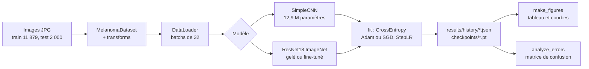
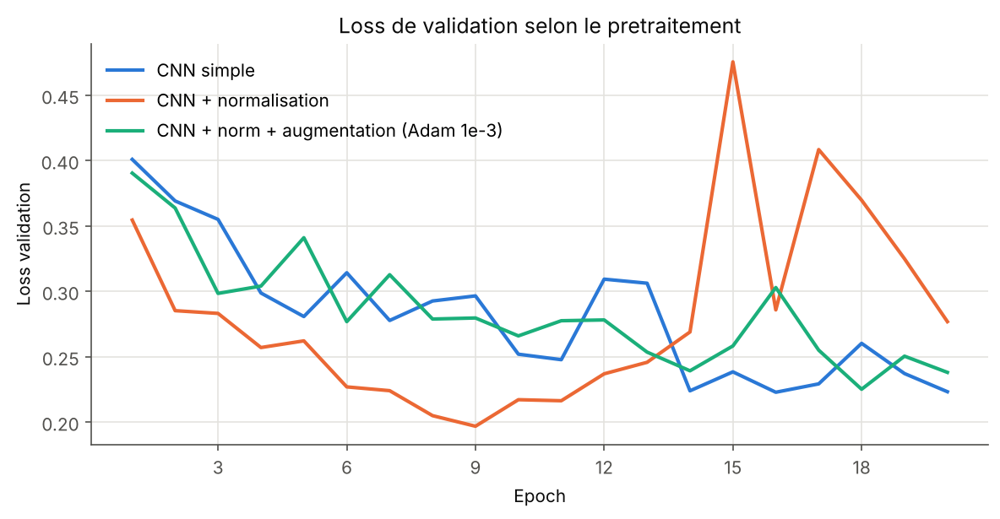
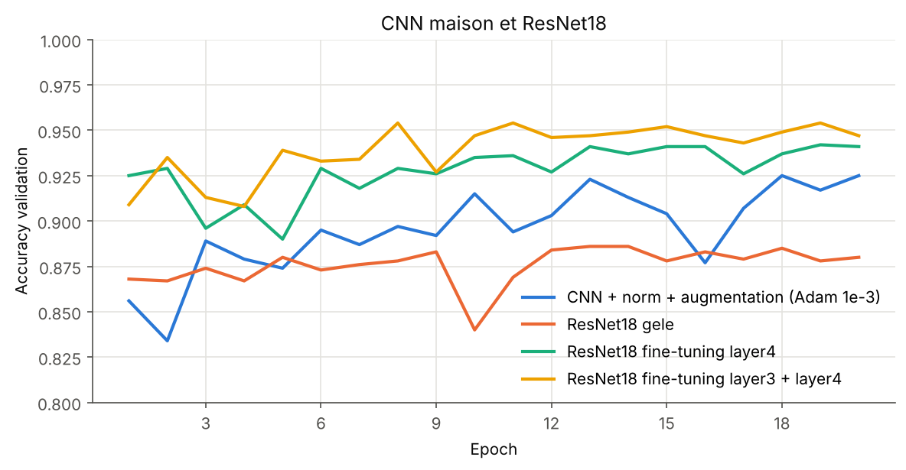

# Classification de lésions cutanées par CNN (PyTorch / CUDA)

Classification binaire d'images dermatoscopiques (bénin / malin) : un CNN entraîné de zéro, amélioré étape par étape, puis comparé à un ResNet18 pré-entraîné sur ImageNet et fine-tuné. Meilleure accuracy de validation : 95,4 % (94,7 % à la dernière epoch).

> Projet étudiant à visée pédagogique. Ce n'est pas un outil médical.

## 1. Contexte

| | |
|---|---|
| Cadre | ENSEIRB-MATMECA (Bordeaux INP), 2e année Télécommunications, semestre 8, module d'apprentissage automatique |
| Format | Projet guidé en 13 parties, évalué par un exposé oral de 10 minutes |
| Dates | avril à mai 2026 |
| Volume horaire | environ 24 h |
| Équipe | binôme avec Yanis André |
| Matériel | machine de l'école, GPU NVIDIA GeForce 12 Go (CUDA 12.0) ; premier essai sur Quadro P620 2 Go abandonné (mémoire insuffisante) |

**Ma contribution.** J'ai exécuté et débogué l'ensemble du pipeline sur le GPU de l'école (15 entraînements de 20 epochs dont les logs sont dans `results/raw_logs/`), diagnostiqué une erreur `CUDA out of memory` et changé de machine, accéléré le chargement des données (`num_workers`), choisi d'ajouter la variante de fine-tuning `layer3 + layer4`, analysé les courbes et la matrice de confusion, et présenté la seconde moitié de l'exposé (de la data augmentation à la conclusion). Le code v1 a été écrit avec l'aide d'un assistant IA, ce que l'énoncé autorise explicitement ; la réorganisation v2 (octobre 2026) aussi. Le détail des changements est dans le [CHANGELOG](CHANGELOG.md).

Présentation de la soutenance : [docs/presentation.pdf](docs/presentation.pdf).

## 2. Principe technique

**Une image est un tenseur.** Une photo RGB de 224 x 224 pixels devient un tableau de forme `[3, 224, 224]` (canaux, hauteur, largeur) dont les valeurs, après `ToTensor()`, sont des flottants entre 0 et 1. Les images sont regroupées en batchs de 32, soit des tenseurs `[32, 3, 224, 224]`.

**Convolution et pooling.** Une couche `Conv2d` fait glisser de petits filtres 3 x 3 sur l'image ; chaque filtre produit une carte qui réagit à un motif local (bord, texture, couleur). `ReLU` met les valeurs négatives à zéro, ce qui rend le réseau non linéaire. `MaxPool2d(2)` garde le maximum de chaque carré 2 x 2 et divise la résolution par deux. Trois blocs font passer l'image de 224 à 28 pixels de côté avec 64 cartes, soit 64 x 28 x 28 = 50 176 valeurs, que deux couches linéaires transforment en 2 scores (un par classe).

**Apprentissage.** La `CrossEntropyLoss` transforme les scores en probabilités (softmax) et vaut `-log(p)` où `p` est la probabilité donnée à la bonne classe : elle est faible quand le réseau est confiant et juste, grande quand il se trompe avec assurance. À chaque batch, la rétropropagation calcule le gradient de cette loss par rapport à chaque poids, et l'optimiseur (Adam ou SGD) déplace les poids dans la direction qui la fait baisser, d'un pas fixé par le learning rate. L'accuracy (pourcentage de bonnes réponses) sert à lire les résultats ; elle n'est pas dérivable et ne sert donc pas à apprendre.

**Améliorations testées, une variable à la fois.**

- *Normalisation* : chaque canal est recentré et réduit, `x' = (x - moyenne) / écart-type`, avec des statistiques calculées sur le train uniquement pour ne rien apprendre de la validation.
- *Data augmentation* : retournement horizontal, rotation de 10° au plus, variation de luminosité et de contraste, appliqués au train seulement. Le réseau ne revoit jamais exactement la même image, ce qui limite la mémorisation (overfitting).
- *Optimiseur et scheduler* : Adam (pas adapté à chaque poids) contre SGD avec momentum ; StepLR divise le learning rate par 10 toutes les 7 epochs (1e-3, 1e-4, 1e-5).
- *Transfer learning* : ResNet18, réseau de 11,2 M de paramètres déjà entraîné sur ImageNet (1,2 million d'images, 1000 classes). On remplace sa dernière couche par une couche à 2 sorties. Soit on gèle tout le reste (`requires_grad = False`, seuls 1 026 paramètres apprennent), soit on dégèle les derniers blocs (`layer4`, puis `layer3`) avec un learning rate 10 fois plus faible que celui de la nouvelle tête, pour ajuster les poids pré-entraînés sans les détruire.

## 3. Architecture



```
melanoma_cnn/        bibliothèque (v2)
  config.py          chemins, MEAN/STD, hyperparamètres
  data.py            MelanomaDataset, make_loader
  transforms.py      pipelines : base, normalisé, augmenté
  models.py          SimpleCNN, resnet18_classifier, count_parameters
  engine.py          train_one_epoch, evaluate, predict, fit
  experiments.py     les 9 configurations comparées
  logs.py, plots.py  lecture des logs, figures (sans torch)
scripts/             points d'entrée (python -m scripts.<nom>)
results/raw_logs/    sorties console réelles des entraînements de mai 2026
results/runs.json    correspondance log -> configuration
original/            code v1 exactement tel que rendu
tests/               tests unitaires (unittest)
```

## 4. Résultats

Tous les chiffres ci-dessous sont recalculés depuis les logs bruts par `python -m scripts.make_figures` (voir `results/summary.md`). Validation : 2 000 images (1 000 par classe), 20 epochs par configuration.

| Configuration | Meilleure acc. val (epoch) | Acc. val finale | Acc. train finale | Paramètres entraînables |
|---|---|---|---|---|
| CNN simple | 93,6 % (20) | 93,6 % | 94,5 % | 12 869 410 |
| CNN + normalisation | 94,5 % (14) | 94,4 % | 98,9 % | 12 869 410 |
| CNN + norm + augmentation, Adam 1e-3 | 92,5 % (18) | 92,5 % | 90,0 % | 12 869 410 |
| idem, Adam 1e-4 | 92,7 % (18) | 91,6 % | 89,8 % | 12 869 410 |
| idem, SGD 1e-2, momentum 0,9 | 91,7 % (19) | 88,9 % | 88,8 % | 12 869 410 |
| idem, Adam 1e-3 + StepLR | 92,5 % (14) | 92,1 % | 90,0 % | 12 869 410 |
| ResNet18 gelé | 88,6 % (13) | 88,0 % | 86,1 % | 1 026 |
| ResNet18 fine-tuning layer4 | 94,2 % (19) | 94,1 % | 98,4 % | 8 394 754 |
| **ResNet18 fine-tuning layer3 + layer4** | **95,4 % (8)** | **94,7 %** | 98,6 % | 10 494 466 |

**Lecture.**

- La normalisation accélère l'apprentissage mais le réseau finit par mémoriser le train (98,9 % contre 94,4 % en validation, pics de loss de validation aux epochs 15 et 17).
- L'augmentation supprime cet écart (90,0 % en train pour 92,5 % en validation) au prix d'environ 2 points de validation sur 20 epochs.
- Le ResNet18 entièrement gelé fait moins bien que le CNN maison : ses caractéristiques apprises sur des photos d'objets ne suffisent pas, avec un simple classifieur linéaire, pour des images de dermatoscopie. Dégeler `layer4` corrige l'essentiel (+5,6 points) ; dégeler aussi `layer3` ajoute environ 1 point.

<p align="center">
  
  
</p>

**Matrice de confusion** (ResNet18 fine-tuning layer4, troisième entraînement, poids de la dernière epoch) :

| | Prédit Benign | Prédit Malignant |
|---|---|---|
| Vrai Benign | 947 | 53 |
| Vrai Malignant | 68 | 932 |

Rappel sur la classe Malignant : 93,2 %, soit 68 lésions malignes classées bénignes sur 1 000. C'est l'erreur la plus coûteuse dans ce contexte.

**Variabilité.** Une même configuration relancée donne des résultats différents (aucune graine aléatoire n'était fixée) : CNN + norm + augmentation 92,5 % puis 90,5 % ; ResNet18 layer4 94,2 %, 94,5 % puis 95,1 %. Les écarts d'environ 1 point entre configurations sont donc à lire comme des tendances.

Autres figures : `figures/generated/` (recalculées depuis les logs) et `figures/original/` (produites en mai 2026, dont les exemples d'images et d'augmentation).

## 5. Installation et utilisation

```bash
pip install -r requirements.txt
# Données : https://www.kaggle.com/datasets/bhaveshmittal/melanoma-cancer-dataset
# à décompresser dans melanoma-cancer-dataset/{train,test}/{Benign,Malignant}/

python -m unittest discover tests          # tests (ceux qui demandent torch sont ignorés sans torch)

# Sans GPU ni dataset : résultats et figures depuis les logs enregistrés
python -m scripts.import_logs
python -m scripts.make_figures

# Avec le dataset (GPU conseillé)
python -m scripts.explore_data             # parties 1 à 3 : exemples, distribution, canaux, batchs
python -m scripts.compute_stats            # moyenne et écart-type du train
python -m scripts.model_summary            # architecture et nombre de paramètres
python -m scripts.train resnet_ft_layer34 --tensorboard
python -m scripts.analyze_errors resnet_ft_layer34
python -m scripts.export_tensorboard && tensorboard --logdir runs
python -m scripts.predict resnet_ft_layer34 image.jpg   # démonstration
```

Les noms de configuration acceptés par `train` sont ceux de `melanoma_cnn/experiments.py`.

## 6. Limites et pistes d'amélioration

- **Pas de jeu de validation distinct.** Le dossier `test` du dataset sert à la fois à choisir la meilleure epoch et à rapporter le score : la « meilleure accuracy » est optimiste. Il faudrait réserver une partie du train pour la validation et n'évaluer le test qu'une fois.
- **Un seul entraînement par configuration** dans le tableau, alors que la variabilité entre essais atteint 2 points. Il faudrait plusieurs graines et une moyenne avec écart-type.
- **Seuil de décision fixe** (classe la plus probable). En contexte médical, on abaisserait le seuil de la classe Malignant pour réduire les 68 faux négatifs, au prix de plus de faux positifs (courbe ROC).
- **ResNet « gelé » pas tout à fait figé** : en mode `train()`, les couches BatchNorm du backbone mettent à jour leurs statistiques même avec `requires_grad = False`.
- **Normalisation du ResNet** : les statistiques du dataset ont été utilisées à la place de celles d'ImageNet, avec lesquelles le réseau a été pré-entraîné. C'est une piste pour expliquer le faible score du ResNet gelé, non testée.
- **Artefacts d'acquisition** : plusieurs images mal classées contiennent des poils, des marques d'encre ou une règle graduée ; le modèle pourrait s'appuyer sur ces éléments. Une carte d'activation (Grad-CAM) permettrait de le vérifier.
- **Données** : deux classes seulement, pas de métadonnées patient ; origine exacte des images non documentée par le dataset.

## 7. Améliorations personnelles (v2, octobre 2026)

Résumé, détail dans le [CHANGELOG](CHANGELOG.md) :

- **Éléments de l'énoncé non terminés en mai** : grille de 12 exemples (au lieu de 4), batch de validation, résumé du modèle, journalisation TensorBoard, matrice de confusion du meilleur modèle (sauvegarde des poids), exemples d'erreurs tirés dans les deux classes.
- **Résultats traçables** : les historiques ne sont plus recopiés à la main dans le code ; ils sont relus depuis les sorties console réelles, et un test vérifie que les valeurs du code d'origine correspondent à ces logs.
- **Code** : un module par rôle, les 9 configurations décrites en un seul endroit, graine aléatoire fixée, fichiers triés, calcul exact de la moyenne et de l'écart-type, tests unitaires.

Les scripts qui utilisent PyTorch ou le dataset n'ont pas pu être exécutés dans l'environnement où la v2 a été écrite ; seuls les tests sans PyTorch, l'import des logs et la génération des figures l'ont été.
