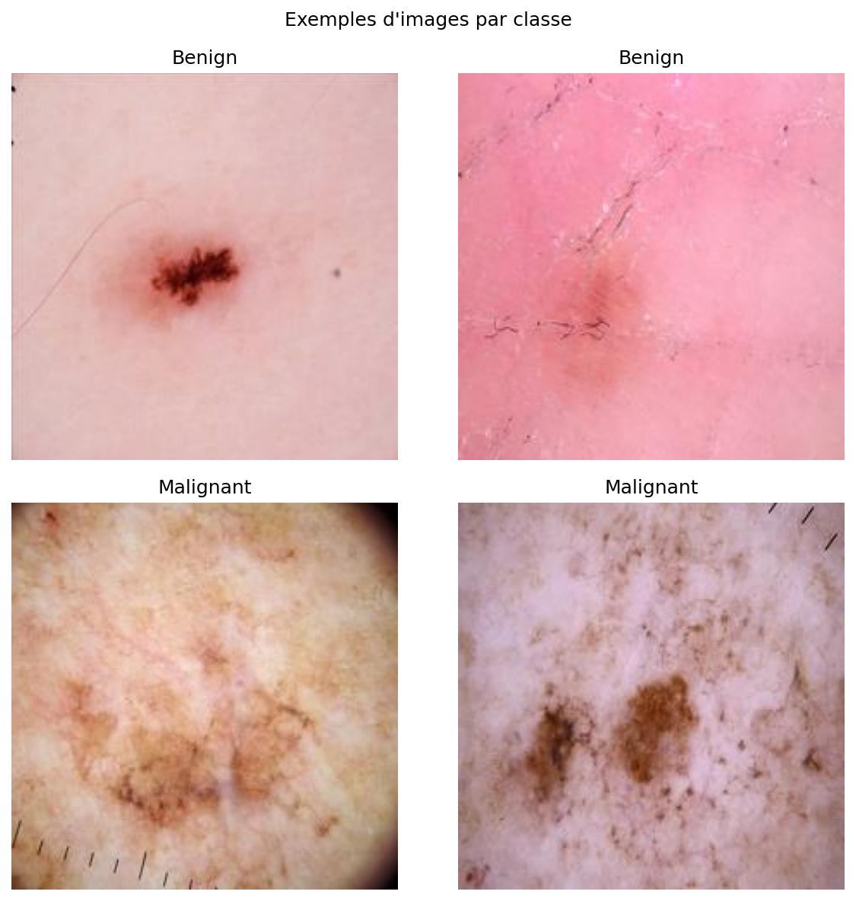
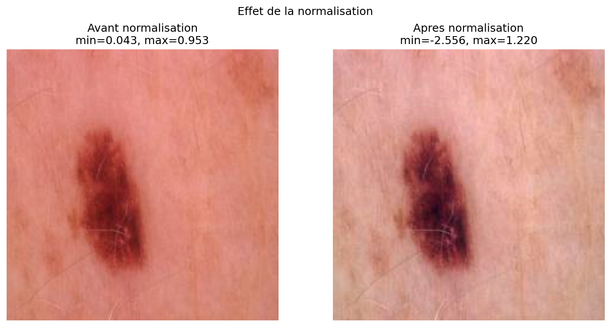
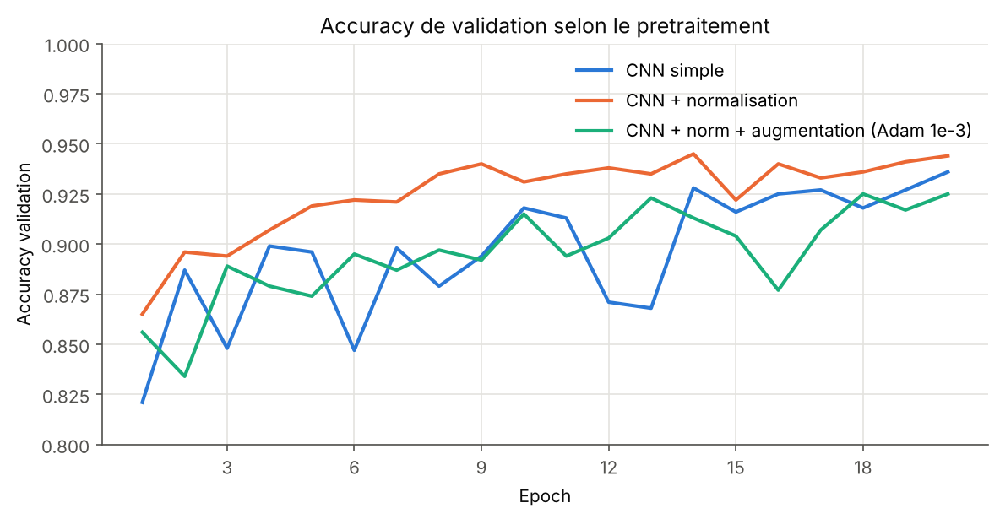
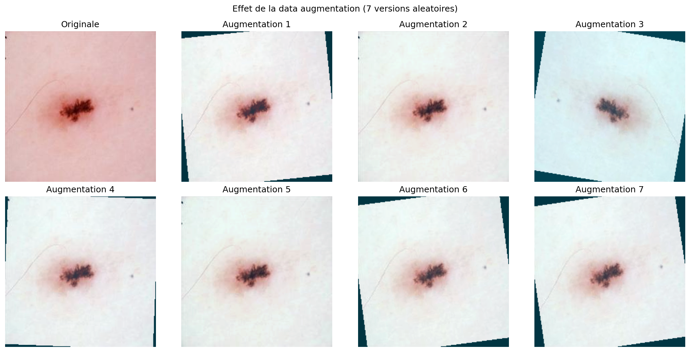
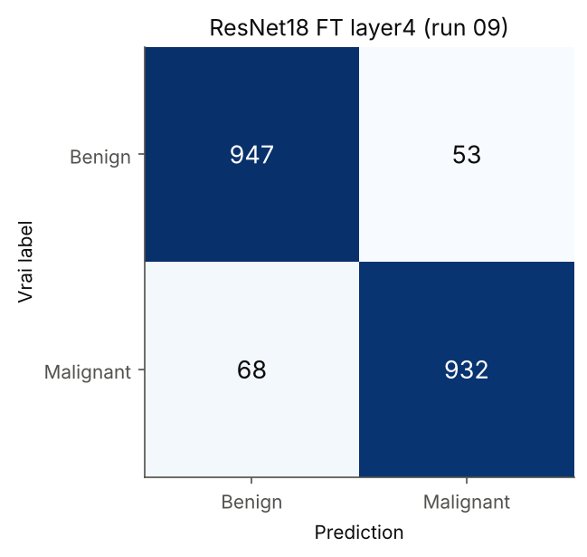
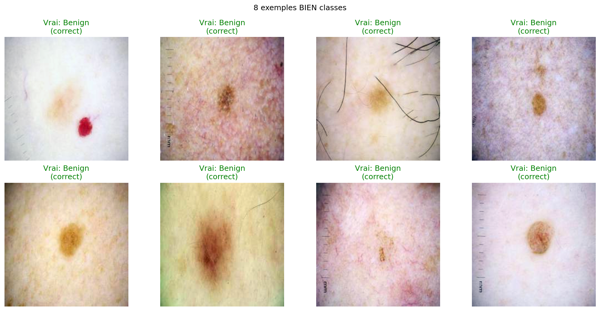
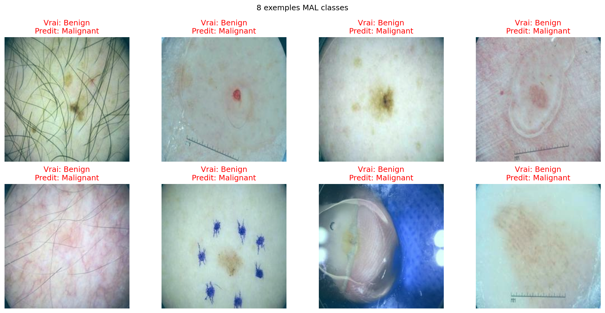

# Détection de mélanomes par CNN (PyTorch)

Un réseau de neurones regarde une photo de grain de beauté prise au dermatoscope et dit s'il est **bénin** ou **malin**. On part d'un petit CNN entraîné de zéro, on l'améliore étape par étape (normalisation, data augmentation, optimiseurs), puis on le compare à un ResNet18 pré-entraîné sur ImageNet et ré-entraîné sur nos images.

**Meilleur résultat : 94,7 % de bonnes réponses** sur 2 000 images jamais vues pendant l'entraînement (ResNet18, fine-tuning des deux derniers blocs).

> Projet étudiant. Ce n'est pas un outil médical.

<p align="center"></p>

| | |
|---|---|
| Cadre | ENSEIRB-MATMECA (Bordeaux INP), 2e année Télécommunications, module d'apprentissage automatique |
| Dates | avril à mai 2026, environ 24 h |
| Équipe | binôme avec Yanis André |
| Matériel | GPU NVIDIA 12 Go de l'école (CUDA), 15 entraînements de 20 epochs |
| Soutenance | [présentation (PDF)](docs/presentation.pdf), exposé oral de 10 minutes |

## Les données

13 879 images dermatoscopiques de 224 x 224 pixels ([dataset Kaggle](https://www.kaggle.com/datasets/bhaveshmittal/melanoma-cancer-dataset)) :

- **entraînement** : 11 879 images (6 289 bénignes, 5 590 malignes) ;
- **validation** : 2 000 images (1 000 de chaque classe), jamais utilisées pour apprendre.

Les deux classes sont presque équilibrées, donc l'accuracy (pourcentage de bonnes réponses) est une mesure honnête ici. Pour le réseau, chaque image est un tableau de nombres de forme `[3, 224, 224]` : 3 canaux de couleur (rouge, vert, bleu), 224 lignes, 224 colonnes, avec des valeurs entre 0 et 1.

## Étape 1 : un CNN simple

Trois blocs `convolution 3x3 → ReLU → max pooling` font passer l'image de 224 à 28 pixels de côté en extrayant 64 cartes de motifs (bords, textures, couleurs). Deux couches linéaires transforment ensuite ces 50 176 valeurs en deux scores, un par classe. Le réseau compte 12,9 millions de paramètres.

Sans aucun prétraitement, il atteint déjà **93,6 %**, mais sa courbe de validation est très irrégulière d'une epoch à l'autre (courbe bleue ci-dessous).

## Étape 2 : normaliser les couleurs

Chaque canal est recentré et réduit : `x' = (x - moyenne) / écart-type`. La moyenne et l'écart-type sont calculés sur les images d'entraînement uniquement, pour ne rien apprendre des images de validation.

<p align="center"></p>

L'apprentissage devient plus rapide et plus stable (courbe orange) : **94,4 %**. Mais le réseau finit par apprendre les images d'entraînement par cœur (98,9 % en entraînement contre 94,4 % en validation). C'est de l'overfitting.

<p align="center"></p>

## Étape 3 : augmenter les données artificiellement

Pour lutter contre l'overfitting, on modifie chaque image d'entraînement au hasard, à chaque passage :

| Opération | Réglage | Pourquoi |
|---|---|---|
| Retournement horizontal | une fois sur deux | une lésion n'a pas de sens gauche-droite |
| Rotation | entre -10° et +10° | le dermatoscope n'est jamais tenu exactement pareil |
| Luminosité et contraste | ± 20 % | l'éclairage change d'une photo à l'autre |

Le réseau ne voit donc jamais deux fois exactement la même image. Ci-dessous, une même lésion et 7 versions tirées au hasard (affichées après normalisation, d'où les couleurs plus pâles ; les coins sombres viennent de la rotation) :

<p align="center"></p>

Résultat : l'écart entre entraînement et validation disparaît (90,0 % contre 92,5 %), au prix d'environ 2 points de validation sur 20 epochs. Le réseau apprend plus lentement, mais il généralise mieux. On a aussi comparé Adam et SGD, et ajouté un scheduler qui divise le learning rate par 10 toutes les 7 epochs. Aucun des deux n'a apporté de gain net (tableau plus bas).

## Étape 4 : partir d'un réseau déjà entraîné (transfer learning)

ResNet18 est un réseau de 11,2 millions de paramètres déjà entraîné sur ImageNet (1,2 million de photos, 1 000 classes). On remplace sa dernière couche par une couche à 2 sorties, puis on teste trois variantes :

- **tout gelé** : seule la nouvelle couche apprend (1 026 paramètres). Résultat : 88,0 %, moins bien que notre CNN. Les motifs appris sur des photos d'objets ne suffisent pas pour de la dermatoscopie ;
- **dernier bloc dégelé** (`layer4`) : 94,1 % ;
- **deux derniers blocs dégelés** (`layer3 + layer4`, la variante que j'ai ajoutée) : **94,7 %**, le meilleur résultat du projet.

Les blocs dégelés apprennent avec un learning rate 10 fois plus faible que la nouvelle couche, pour ajuster les poids pré-entraînés sans les détruire.

<p align="center"></p>

## Résultats

| Configuration | Accuracy validation (finale) | Meilleure epoch | Accuracy entraînement |
|---|---|---|---|
| CNN simple | 93,6 % | 93,6 % | 94,5 % |
| CNN + normalisation | 94,4 % | 94,5 % | 98,9 % |
| CNN + normalisation + augmentation, Adam | 92,5 % | 92,5 % | 90,0 % |
| idem, SGD avec momentum | 88,9 % | 91,7 % | 88,8 % |
| idem, Adam + scheduler StepLR | 92,1 % | 92,5 % | 90,0 % |
| ResNet18 gelé | 88,0 % | 88,6 % | 86,1 % |
| ResNet18, fine-tuning `layer4` | 94,1 % | 94,2 % | 98,4 % |
| **ResNet18, fine-tuning `layer3 + layer4`** | **94,7 %** | **95,4 %** | 98,6 % |

Tous ces chiffres sont recalculés automatiquement à partir des sorties console réelles des entraînements ([`results/raw_logs/`](results/raw_logs/), détail dans [`results/summary.md`](results/summary.md)). Une même configuration relancée varie d'environ 1 à 2 points : les petits écarts du tableau sont des tendances, pas des certitudes.

### Où le modèle se trompe

Analyse faite sur le ResNet18 `layer4` (94,0 % sur cet entraînement), le seul dont on avait gardé les poids en mai.

<p align="center"></p>

Sur 1 000 lésions malignes, **68 sont classées bénignes**. C'est l'erreur la plus grave dans ce contexte : un mélanome non détecté. En face, 53 lésions bénignes sont classées malignes (fausse alerte).

Bien classées :

<p align="center"></p>

Mal classées (bénignes prédites malignes) :

<p align="center"></p>

Les erreurs ont souvent un point commun : **des poils, une règle graduée, des marques d'encre ou un reflet** couvrent une partie de l'image. Le modèle s'appuie peut-être sur ces éléments plutôt que sur la lésion elle-même. Une carte d'activation (Grad-CAM) permettrait de le vérifier.

## Limites

- Le dossier `test` du dataset sert à la fois à choisir la meilleure epoch et à donner le score final : la colonne « meilleure epoch » est donc optimiste. Il faudrait garder une partie de l'entraînement pour la validation et n'utiliser le test qu'une seule fois.
- Le seuil de décision est fixe (on prend la classe la plus probable). En médecine, on l'abaisserait pour la classe maligne afin de rater moins de mélanomes, quitte à avoir plus de fausses alertes.
- Pour le ResNet18, on a utilisé la normalisation de notre dataset au lieu de celle d'ImageNet, avec laquelle il a été pré-entraîné. C'est une piste pour expliquer le score faible du ResNet gelé, non testée.
- Deux classes seulement, pas de données sur les patients.

## Lancer le code

```bash
pip install -r requirements.txt
python -m unittest discover tests        # 12 tests

# Sans GPU ni dataset : tableau et courbes recalculés depuis les logs
python -m scripts.import_logs
python -m scripts.make_figures

# Avec le dataset Kaggle dans melanoma-cancer-dataset/{train,test}/{Benign,Malignant}/
python -m scripts.explore_data           # exemples, distribution des classes, batchs
python -m scripts.train resnet_ft_layer34
python -m scripts.analyze_errors resnet_ft_layer34
python -m scripts.predict resnet_ft_layer34 image.jpg
```

Les noms de configuration acceptés sont ceux de [`melanoma_cnn/experiments.py`](melanoma_cnn/experiments.py). Les tests et `explore_data` ont été vérifiés en octobre 2026 (Python 3.14, PyTorch CPU, dataset complet).

```
melanoma_cnn/   données, transformations, modèles, boucle d'entraînement, figures
scripts/        un script par étape (python -m scripts.<nom>)
results/        logs bruts des 15 entraînements et résultats calculés
figures/        figures de la soutenance (original/) et recalculées (generated/)
original/       code tel que rendu en mai 2026
tests/          tests unitaires
```

## Ma contribution

J'ai exécuté et débogué tous les entraînements sur le GPU de l'école, réglé une erreur `CUDA out of memory` en changeant de machine, accéléré le chargement des données, ajouté la variante de fine-tuning `layer3 + layer4`, analysé les courbes et les erreurs, et présenté la seconde moitié de l'exposé (de la data augmentation à la conclusion).

Le code a été écrit avec l'aide d'un assistant IA, ce que l'énoncé autorisait. Après la soutenance, je l'ai réorganisé en modules et complété (sauvegarde du meilleur modèle, exemples d'erreurs tirés dans les deux classes, graine aléatoire fixée, tests). Le détail est dans le [CHANGELOG](CHANGELOG.md), et la version rendue est conservée dans [`original/`](original/).

---

Yanis Djelali, élève ingénieur en télécommunications, ENSEIRB-MATMECA.
